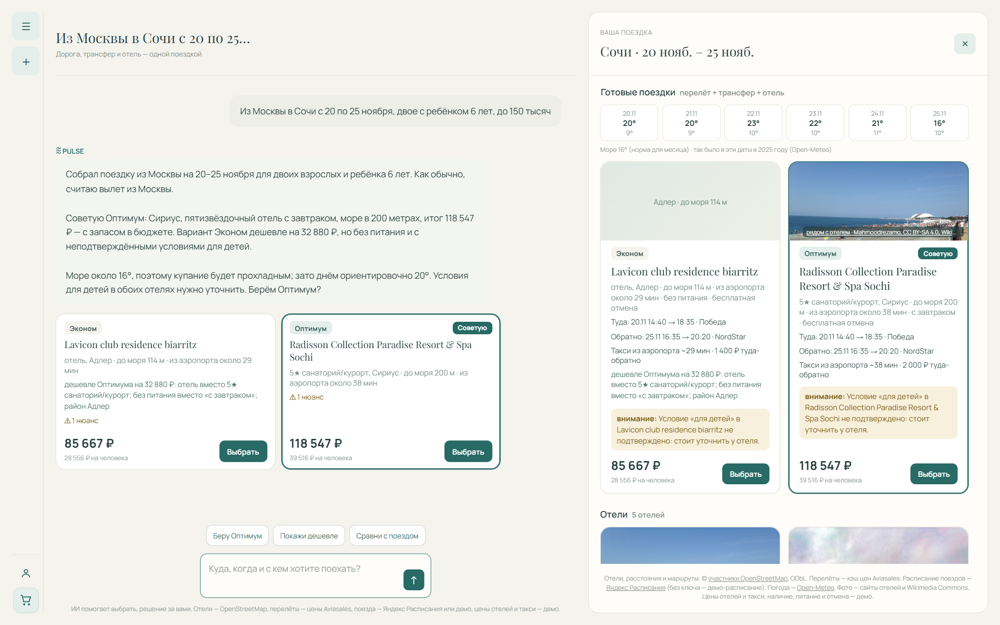
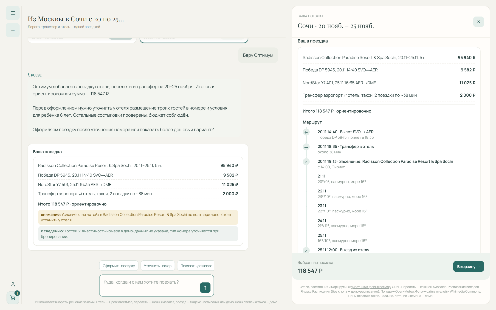
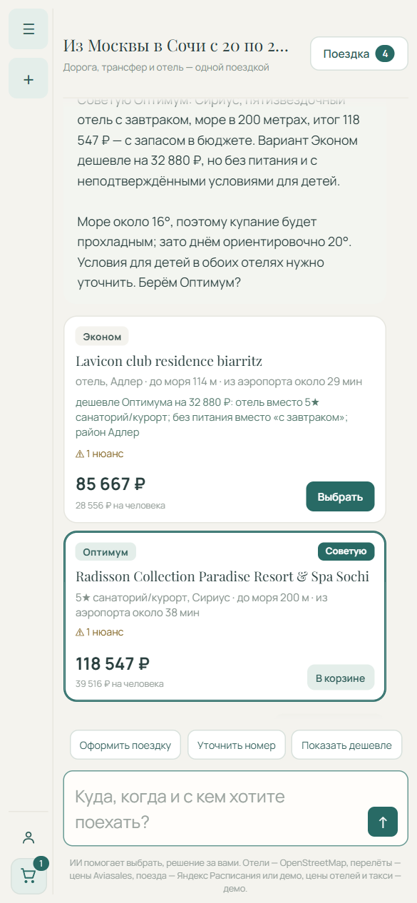

# Pulse — ИИ-агент, который собирает поездку целиком (трек Островок «О!дин запрос»)

Из одного сообщения («из Москвы на майские, двое с ребёнком, до 150 тысяч») агент сам понимает даты
и скрытые требования. Он собирает 2–3 готовые поездки: самолёт или поезд, трансфер и отель с одной
итоговой суммой. Затем объясняет разницу в рублях, проверяет состыковки и оформляет заказ по кнопке.
После покупки переносит заказ на другие даты и добавляет трансфер к купленному отелю.

Главная идея: **суммы и состыковки считает код, а модель только объясняет.** Поэтому итог всегда
сходится, а поездку с ночным прилётом после заезда или хостелом для семьи нельзя оплатить.

- Видео-скринкаст: **[Cсылка на видео](https://mega.nz/file/DiATDTIB#Rj_2l0FtZYDl1J-SaKMCeZ_M2fiIwdB-8C7BJoOfY8k)**
- Развёрнутый сервис: https://ostrovok.kosmoweb.ru
- Локация — Большой Сочи (1 358 отелей из OpenStreetMap). Новый город — это один файл с описанием
  места, код агента не меняется ([docs/DATA.md](docs/DATA.md)).



| Корзина и маршрут по часам | Мобильная версия |
|---|---|
|  |  |

## Быстрый старт

```bash
git clone https://github.com/ostrovok-hackathon-2026/pulse.git
cd pulse
cp .env.example .env   # впишите LLM_API_KEY (и по желанию TRAVELPAYOUTS_TOKEN, YANDEX_RASP_KEY)
docker compose up --build
# открыть http://localhost:8080
```

Для жюри ключи лежат в `secrets.env.age` (отдельные ключи с лимитом расходов). Расшифруйте его в `.env`
вместо `cp .env.example .env`:

```bash
age -d -i <закрытый-ключ-организаторов> -o .env secrets.env.age
```

Нужны Docker и Docker Compose v2. Сборка занимает меньше минуты, сервис готов, когда
`docker compose ps` показывает `healthy`.

### Проверка за пять минут

Откройте http://localhost:8080 и отправьте в одном чате по очереди:

1. «Из Москвы в Сочи на майские, двое с ребёнком 6 лет, до 150 тысяч» — агент сам находит даты
   праздников и показывает поездки «Эконом / Оптимум / Комфорт» с одной суммой, погодой и разницей
   в рублях. Детали, фото и маршрут — в панели «Поездка» справа.
2. «А на два дня позже?» — пересборка: меняются только даты, агент говорит, что изменилось.
3. «Беру Оптимум» — корзина, проверка состыковок и маршрут по часам. Оплата только по кнопке,
   после неё — номер заказа в профиле.
4. «Перенесите на день позже» — тот же отель и дорога на новые даты с разницей в рублях.

Незнакомые запросы тоже можно проверить: «тёплое море в ноябре», «с собакой», «дороговато»,
«Питер на выходные».

## Что умеет агент

| Задача трека | Как сделано |
|---|---|
| Понимание запроса | «С ребёнком» — без хостелов, «с собакой» — с животными, «на майские» — из производственного календаря. Уточняет только даты или состав гостей, одним вопросом. Остальное додумывает и называет допущением. |
| Вдохновение | Сам выбирает район по характеру поездки. На желание не по сезону («тёплое море в ноябре») честно говорит, как будет, и предлагает, что подойдёт. |
| Подбор и сравнение | Пакеты «Эконом / Оптимум / Комфорт»: дорога туда и обратно, трансфер и отель с одной суммой. Сравнение в рублях и даты подешевле (±3 дня). |
| Объяснение | Что получаешь и чем жертвуешь в каждом пакете. Пометки «демо» и «нет данных», без выдуманных отзывов. |
| Сборка и покупка | Корзина, проверка состыковок (прилёт после заезда, ночь без жилья, хостел для семьи, бюджет), маршрут по часам. Оплата только по кнопке. |
| Пересборка | «На два дня позже», «дешевле», «поездом» — меняет только названное и говорит, что изменилось. |
| После покупки | Перенос дат (старый заказ отменяется только после оплаты нового), трансфер к купленному отелю, ранний заезд как просьба к отелю. |
| Память, метрики, мобильная версия | Город вылета, состав семьи и предпочтения между чатами (видно и стирается в профиле). 24 сценария с метриками. Адаптивная вёрстка. |

Для отеля: хостел не продаётся семье с ребёнком, неподтверждённые удобства («с животными») не обещаются
гостю, о раннем прилёте и часе заселения гость знает до оплаты. Меньше конфликтов на ресепшене и отмен.

## Как встроить в Островок

Агент работает с моделями `HotelOption`, `FlightOption`, `TransferOption`, `Order`
(`backend/agent/contracts.py`), а источники вызывает только через реестр `backend/agent/providers.py`.
Подключить API Островка — значит написать классы с этими протоколами и указать
`PULSE_PROVIDERS=модуль:функция`. Код агента не меняется. Сборка пакетов и проверка поездки работают
и без LLM, например как проверка корзины «отель + билеты» в обычной воронке.

Соответствие шагам ETG API v3, план замены каждого блока и бизнес-метрики — в
[docs/OSTROVOK.md](docs/OSTROVOK.md).

## Качество

Последний полный прогон 24 сценариев на `claude-haiku-5-5` ([отчёт](evals/results/20261029-043956.md)):

| Метрика | Значение |
|---|---|
| Сценарии доведены до конца | 24/24, проверок 107/107 |
| Уточняющих вопросов до первого варианта, в среднем | 0 |
| Секунд до первого варианта, медиана | 30 |
| Пакетов без проблем состыковки | 42/42 |

Сценарии, тесты, публичные трассы в LangSmith и найденные прогонами ошибки — в
[docs/QUALITY.md](docs/QUALITY.md).

## Модель

Провайдер — [smartapi.pro](https://api.smartapi.pro/v1) (OpenAI-совместимый API), модель — **`claude-haiku-5-5`**.
Подойдёт любая OpenAI-совместимая модель с вызовом инструментов: задайте `LLM_BASE_URL` и `LLM_MODEL`.

## Зависимости и переменные окружения

Рекомендованные ресурсы: 1 CPU, 512 МБ RAM (в простое около 100 МБ). Образ — около 350 МБ.
Внешних сервисов в compose нет: пользователи, чаты, состояние диалогов, память, заказы и кэши
хранятся в SQLite в томе `pulse-data` (`/app/data`). Пустое значение в `.env` — то же, что не задано.

| Переменная | По умолчанию | Назначение |
|---|---|---|
| `LLM_API_KEY` | — (**обязательно**) | ключ провайдера модели |
| `LLM_BASE_URL` | `https://api.smartapi.pro/v1` | адрес OpenAI-совместимого API |
| `LLM_MODEL` | `claude-haiku-5-5` | модель агента |
| `LLM_FALLBACK_MODELS` | пусто | запасные модели через запятую: при 429 или сбое |
| `STRUCTURED_REPLY` | `1` | `0` — финальный ответ обычным текстом, для слабых в tool calling моделей |
| `TRAVELPAYOUTS_TOKEN` | пусто | цены перелётов Aviasales; без него поездка собирается поездом |
| `YANDEX_RASP_KEY` | пусто | настоящее расписание поездов (Яндекс Расписания); без него — демо |
| `PULSE_LOCATION` | `sochi` | локация: папка в `backend/seed/` |
| `PULSE_PROVIDERS` | `demo` | источники отелей, билетов и заказов ([docs/OSTROVOK.md](docs/OSTROVOK.md)) |
| `PULSE_AUTH_KEY` | генерируется | ключ подписи сессий; без него создаётся и хранится в томе |
| `PULSE_DB_PATH`, `DATA_DIR` | `/app/data/…` в Docker | база пользователей и чатов; память, заказы, кэши |
| `HTTP_TIMEOUT` | `20` | таймаут внешних API, секунд |
| `AGENT_RECURSION_LIMIT` | `60` | предел шагов агента за ход |
| `AGENT_MEMORY_MAX_CHARS` | `512` | длина памяти о пользователе |
| `LOG_LEVEL` | `INFO` | подробность логов |
| `LANGSMITH_TRACING`, `LANGSMITH_API_KEY`, `LANGSMITH_PROJECT` | выключено | трассировка ходов в LangSmith |

## Сидирование

Ничего делать не нужно: отели лежат в репозитории (`backend/seed/sochi/hotels.json`) и попадают в образ,
таблицы создаются при первом старте. Обновить выгрузку из OpenStreetMap: `make seed LOCATION=sochi`.

## Маршруты и доступ

- `/` — веб-интерфейс: чат с карточками, панель «Поездка» (детали, корзина, маршрут), профиль и заказы.
- `/health` — `200 OK`, `{"status": "ok"}` (проверяет и базу).
- `POST /api/chat` — сообщение агенту, ответ потоком SSE. Остальные роуты — в [docs/AGENT.md](docs/AGENT.md).
- Тестовый пользователь не нужен: гостевой аккаунт создаётся при первом заходе.

`make up`, `make logs`, `make test` (ядро без ключей и сети), `make evals` (сценарии на настоящей модели),
`make down`, `make reset` — короткие команды для того же через Docker.

## Ограничения

- Цены отелей, наличие, питание, отмена и такси — демо-модель (подписано в интерфейсе и в ответах).
  Перелёты — реальные недавние цены из кэша Aviasales, не бронь. Все источники — в [docs/DATA.md](docs/DATA.md).
- 10–40 секунд до первого варианта: почти всё это время — ответы модели. Карточки приходят раньше текста.
- Один воркер и SQLite; путь к нескольким — `PostgresSaver` и Postgres, код агента не меняется.
- Один запуск обслуживает одну локацию.

## Документация

- [docs/AGENT.md](docs/AGENT.md) — устройство агента, API, события потока, структура кода, запуск без Docker.
- [docs/OSTROVOK.md](docs/OSTROVOK.md) — подключение к API Островка.
- [docs/QUALITY.md](docs/QUALITY.md) — тесты, сценарии, метрики, наблюдаемость.
- [docs/DATA.md](docs/DATA.md) — источники данных и как добавить город.
